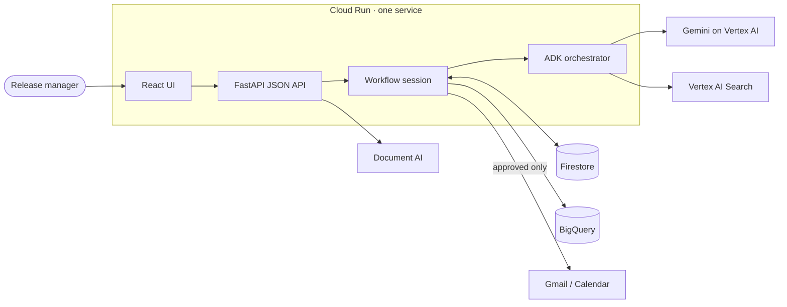

# WorkPilot AI

**WorkPilot is a stateful enterprise AI agent that turns knowledge into decisions, decisions into approved actions, and actions into measurable outcomes.**

AI Builder Cup 2026 · Team **GENI** · Problem statement: **Future of Work & Enterprise Productivity**

| | |
|---|---|
| **Live prototype** | **https://workpilot-geni-475836937080.asia-south1.run.app** |
| **Repository** | https://github.com/CodeByKodi/2026aibuildercup-geni |
| **Demo video** | **[Watch the 2:32 demo](https://cdn.jsdelivr.net/gh/CodeByKodi/2026aibuildercup-geni@main/demo/workpilot-demo.mp4)** (plays in the browser) · [file in this repo](demo/workpilot-demo.mp4) · [storyboard and narration](demo/STORYBOARD.md) |

The live prototype is public, with no sign-in, on Cloud Run (asia-south1), deployed from this repository.

## Problem statement

Enterprise decisions such as *"can we ship this release?"* depend on knowledge scattered
across status reports, security assessments, test results, meeting notes and trackers. A
person reads all of it, works out what blocks the decision, chases owners, and later tries to
remember whether the agreed actions actually happened. Chat assistants answer the question
and stop there: no owned actions, no approval trail, no check that the outcome was achieved.

## What WorkPilot does

```
Knowledge → Analyze → Decision → Actions → Approval → Outcome → Impact
```

1. **Knowledge:** searches the enterprise workspace with Vertex AI Search and shows the cited evidence.
2. **Analyze:** an ADK agent reasons over that evidence with Gemini and finds the blockers.
3. **Decision:** records a Decision Record: verdict, rationale, key evidence, approval conditions.
4. **Actions:** proposes one Action Contract per blocker: owner, due date, expected outcome, evidence.
5. **Approval:** the agent **pauses**. A person approves or rejects, then runs approved work as a real Gmail draft or Calendar event.
6. **Outcome:** a person records what actually happened; the agent proposes a status; the person confirms.
7. **Impact:** the agent **resumes from Firestore**, reassesses readiness and estimates the time saved, with its formula.

## Enterprise demo scenario: Release Readiness

Maya Chen, release manager for the fictional *Customer Portal v12.4*, has six sources and
one question:

> *"Are we ready to go live? What is blocking the release, what should we prioritize this
> week, who owns each action, and what must be completed before approval?"*

WorkPilot answers **NOT READY**: three blockers (security finding SEC-217, Customer Profile API
p95 above the 1.5 s gate, UAT defect PAY-482), three owners and three approval conditions.
Once the approved actions have run and a person confirms each outcome as achieved, readiness
moves to **READY FOR APPROVAL**. Go-live approval itself always stays with a person.

## Demo

The [2:32 demo video](https://cdn.jsdelivr.net/gh/CodeByKodi/2026aibuildercup-geni@main/demo/workpilot-demo.mp4) walks the scenario above on the live URL, from the question to
**NOT READY → READY FOR APPROVAL** and the impact. Clicks and talking points for a live run are in
[docs/demo-flow.md](docs/demo-flow.md). [`demo/record-demo.mjs`](demo/record-demo.mjs) re-records the
video against any deployment ([storyboard](demo/STORYBOARD.md)).

## Guardrails and proof

- **Cited, or not at all:** every blocker cites its sources, and a citation opens the exact passage. A question the workspace cannot answer returns *Not found* instead of a guess.
- **People hold every gate:** no agent tool can approve, execute or confirm. Execution counts only when Gmail or Calendar returns an id, and only an outcome a person confirms as *achieved* closes a condition.
- **Your own documents:** uploads are searched with the workspace; Document AI reads scanned PDFs and images.
- **Persistent workflow memory:** every step lives in Firestore, so a session link restores it on any instance. Decision Memory keeps expected against actual outcomes.
- **Impact you can check:** estimated time saved = manual baseline (a published formula) − WorkPilot's run (measured on the server). An Impact & Proof strip on every step, plus an audit trail of event ids in Firestore and BigQuery.

## Google Cloud technologies

| Service | Role in WorkPilot | Status in the prototype |
|---|---|---|
| **Gemini on Vertex AI** | Reasoning for the decision, Action Contracts and outcome proposals | Live |
| **Google ADK** | Orchestrator agent with Knowledge, Decision, Action, Outcome and Workflow-memory tools; pauses at the human gate and resumes from Firestore | Live |
| **Vertex AI Search (Agent Search)** | Grounded retrieval over the workspace documents | Live; labelled local fallback if unavailable |
| **Document AI** | OCR for uploaded scanned PDFs and images | Live; local parsers if not configured |
| **Cloud Run** | Single public service: React UI, FastAPI API and the ADK agent | Live |
| **Firestore** (Firebase Admin SDK) | Sessions, Decision Records, Action Contracts, executions, audit events | Live |
| **BigQuery** | Append-only event analytics | Live when enabled; the Firestore audit trail always |
| Gmail / Calendar APIs + Secret Manager | Run approved actions as drafts/events via one-time user OAuth | Live when the token secret exists |

Vertex AI Agent Engine and AlloyDB are **not used** ([why](docs/google-cloud-setup.md#design-choices)).
**System Status** in the app shows which services are live on the running deployment.

## Architecture



Request flow, guardrails, data model and fallbacks: [docs/architecture.md](docs/architecture.md).

```
frontend/      React + Vite + TypeScript UI (seven steps, sidebar pages)
workpilot/     Python backend: api.py (FastAPI), agent/ (ADK tools + orchestrator),
               workflow_session.py, workflow.py, impact.py, and the Google Cloud adapters
               (ai, enterprise_search, document_ai, state_store, analytics, execution)
sample_data/   Synthetic Release Readiness workspace (+ a scanned PDF for Document AI)
tests/         pytest unit and API tests · tests/e2e/ Playwright end-to-end tests
scripts/       bootstrap_cloud.py (Search, Document AI, BigQuery) · authorize_workspace_oauth.py
docs/          architecture · Google Cloud setup · demo flow · submission notes
```

## Local setup

Requirements: Python 3.11+, Node 20+.

```bash
git clone https://github.com/CodeByKodi/2026aibuildercup-geni.git
cd 2026aibuildercup-geni
python3 -m venv .venv && source .venv/bin/activate
pip install -r requirements-dev.txt
npm --prefix frontend ci
npm ci && npx playwright install chromium
cp .env.example .env
```

## Environment variables

[`.env.example`](.env.example) lists every variable, marked **REQUIRED**, **OPTIONAL** or with
its **FALLBACK**. With the defaults (`DEMO_MODE=true`) nothing needs Google credentials: the app
runs in memory with deterministic, labelled fallbacks. For Google Cloud, set `DEMO_MODE=false`
and `GOOGLE_CLOUD_PROJECT`, sign in with `gcloud auth application-default login`, and enable
the optional services you have provisioned.

## Run locally

```bash
npm --prefix frontend run build                     # builds frontend/dist
set -a && source .env && set +a
uvicorn workpilot.api:app --port 8080               # http://127.0.0.1:8080
```

For UI work with hot reload, run uvicorn on `--port 8000` and `npm --prefix frontend run dev`
(Vite on :5173, proxying `/api` to :8000).

## Testing

```bash
pytest                                              # unit + API tests, no cloud calls
npm --prefix frontend run build                     # TypeScript type check + production build
npx playwright test smoke.spec.ts                   # smoke test against http://127.0.0.1:8080
WORKPILOT_BASE_URL=<deployed-url> npx playwright test                        # full regression
WORKPILOT_BASE_URL=<deployed-url> WORKPILOT_E2E_EXECUTE=1 npx playwright test demo.spec.ts
```

The full regression is written for a deployment with the Google services on (Vertex AI
Search, Gemini via ADK, Document AI); the upload spec skips itself when Document AI is not
live. `demo.spec.ts` is the panel journey, from a fresh session to READY FOR APPROVAL with a
reload after every stage. It creates real Gmail drafts in the connected mailbox (never sent),
so it only runs with `WORKPILOT_E2E_EXECUTE=1`. HTML report: `npx playwright show-report`.

## Deploy to Cloud Run

```bash
gcloud auth login && gcloud auth application-default login
./deploy-cloud-run.sh <project-id> asia-south1 <service-name>
```

Safe to rerun. Full setup, including Vertex AI Search, Document AI, BigQuery and the optional
Gmail/Calendar consent: [docs/google-cloud-setup.md](docs/google-cloud-setup.md).

## Repository and submission notes

All enterprise data in this repository is **synthetic**: a fictional release and fictional
people. No secrets are committed; credentials come from Application Default Credentials and
Secret Manager. Known limitations and roadmap: [docs/submission-notes.md](docs/submission-notes.md).

Licensed under the [Apache License 2.0](LICENSE).
