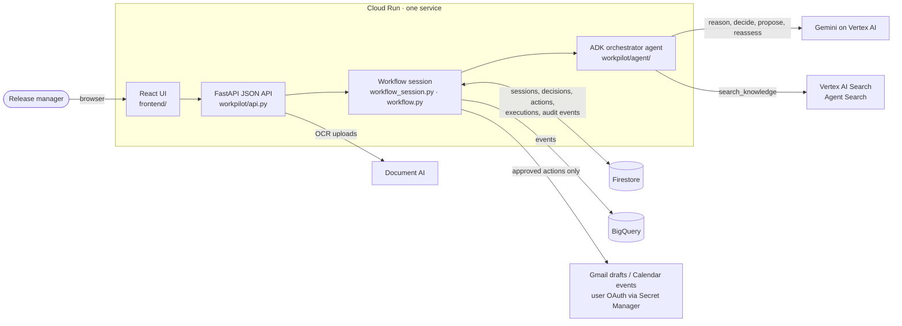

# Architecture

WorkPilot is one Cloud Run service. A FastAPI app serves the React UI and a JSON API; the
API drives a stateful workflow whose agent turns run on Google ADK with Gemini on Vertex AI.
All workflow state lives in Firestore, so any instance can serve any request and a session
link (`?s=SES-…`) restores the whole workflow.

## Request flow

1. **Start / Knowledge.** `POST /api/sessions/{id}/retrieve` searches Vertex AI Search over
   the six-document workspace, plus the session's own uploads (searched locally, never added
   to the shared index). Hits are scoped to workspace documents and carry source and section.
2. **Analyze.** `POST /api/sessions/{id}/analyze` streams the agent's Decide turn as NDJSON;
   each stage event carries a server-measured time. The agent calls `search_knowledge`,
   reasons with Gemini, and records a **Decision Record** (verdict, blockers, owners,
   approval conditions, cited evidence) with `create_decision`.
3. **Actions.** The agent's contract turn proposes one **Action Contract** per blocker
   (owner, due date, priority, expected outcome, evidence). All start `PROPOSED`.
4. **Approval (human gate).** The agent pauses. A person approves or rejects each contract,
   then runs the approved ones; each becomes a Gmail draft (never sent) or a Calendar event
   and is marked `EXECUTED` only when Google returns an ID.
5. **Outcome & Impact.** A person writes what actually happened; the agent proposes a status;
   the person confirms. Only an `ACHIEVED` outcome closes an approval condition. The agent
   then **resumes from Firestore** (`get_workflow_context`, `get_action_status`,
   `assess_readiness`, `calculate_impact`) and reports readiness and estimated time saved.

## Agent and guardrails

- Tools are grouped by job: Knowledge, Decision, Action, Outcome and Workflow memory
  (`workpilot/agent/*.py`). The orchestrator (`agent/orchestrator.py`) runs four turns:
  Decide, Contracts, Reassess (outcome proposal) and Resume.
- **No agent tool can approve, reject, execute, or confirm an outcome.** Those are separate
  API endpoints that a person clicks.
- Readiness comes from the tool's computation (`presentation.verdict`), never from the
  model's wording. **READY FOR APPROVAL** is the best status; go-live approval stays human.
- If the agent's resume turn does not complete, WorkPilot re-reads the saved workflow,
  recomputes readiness with the same functions, and says so on screen.

## Data model

Firestore, under `workpilot_workspaces/{WORKPILOT_WORKSPACE}`:

| Collection | Holds |
|---|---|
| `sessions` | One workflow: question, retrieved evidence, analysis snapshot, contract ids, agent messages, uploads, stage, readiness |
| `decisions` | Decision Records: finding, recommendation, rationale, conditions, evidence, expected vs actual outcome |
| `actions` | Action Contracts with approval, execution and outcome state |
| `executions` | Gmail/Calendar receipts (the reference Google returned) |
| `audit_events` | Every step with an event id, actor and time; mirrored to BigQuery when enabled |
| `knowledge_sources`, `session_documents` | Source metadata; text of documents uploaded into one session |

## Resilience and honesty

Each Google service is feature-flagged with a labelled fallback, so the URL keeps working
and never overstates what ran:

| Service | When unavailable |
|---|---|
| Vertex AI Search | Local TF-IDF retrieval, labelled `Local TF-IDF (FALLBACK)` |
| ADK agent | Deterministic Gemini pipeline (or demo synthesis in `DEMO_MODE`), labelled with its mode |
| Document AI | Local PDF/DOCX/text parsers; an image-only PDF cannot be read and says so |
| BigQuery | Events are still written to the Firestore audit trail |
| Gmail / Calendar | Run buttons disabled; actions stay "Not started" |

System Status (`GET /api/status`) reports a service as ACTIVE only after a live check.
Vertex AI Agent Engine and AlloyDB are deliberately **not used**: the agent runs inside the
Cloud Run service and its state already lives in Firestore.
